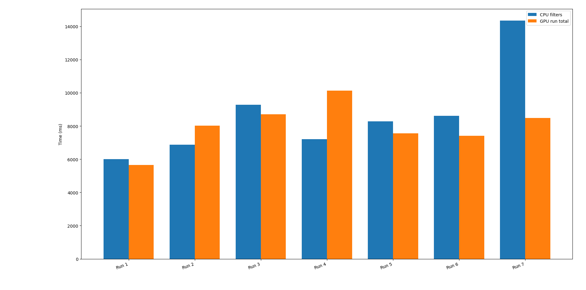

# TaskFlow + cudaFlow: GPU-Accelerated Image Filtering

A C++ image-processing project that compares CPU and CUDA GPU implementations of Gaussian blur and Sobel edge detection. Taskflow organizes processing work into task graphs, while cudaFlow executes GPU operations through a CUDA graph.

## Overview

The application processes grayscale images in two stages:

1. **Gaussian blur** smooths the image and reduces high-frequency detail.
2. **Sobel edge detection** highlights intensity changes to produce an edge map.

Both filters have CPU and GPU implementations. The application can process batches of images, save outputs from both pipelines, record timing results, and validate CPU/GPU outputs pixel by pixel.

## Features

- OpenCV-based grayscale image loading and preprocessing.
- CPU implementations of 3×3 Gaussian blur and Sobel edge detection.
- CUDA kernels implementing the same filters.
- Taskflow task graphs for coordinating batch processing.
- cudaFlow/CUDA graph execution for GPU filtering.
- Reusable GPU buffers and a CUDA stream.
- Measurements for preprocessing, filtering, transfers, and overall pipeline execution.
- Pixel-by-pixel CPU/GPU validation.
- CSV benchmark output for plotting and analysis.

## Processing Pipeline

```text
Input images
    |
    v
OpenCV grayscale loading / preprocessing
    |
    +------------------------------+
    |                              |
    v                              v
CPU pipeline                   GPU pipeline
Gaussian blur                  Host-to-device copy
    |                              |
    v                              v
Sobel edge detection           CUDA Gaussian blur
    |                              |
    v                              v
Save CPU outputs               CUDA Sobel edge detection
                                   |
                                   v
                              Device-to-host copy
                                   |
                                   v
                              Save GPU outputs
```

CPU and GPU pipelines are timed separately. GPU measurements can include transfers and pipeline execution; one-time GPU setup is reported separately. Task-duration sums may exceed wall-clock time when tasks overlap, so they should not be treated as equivalent measurements.

## Technologies

- C++
- NVIDIA CUDA
- Taskflow and cudaFlow
- OpenCV
- CMake
- Python and Matplotlib for benchmark plotting

The host compiler must be compatible with the installed CUDA Toolkit. The build commands below use GCC 13 as an example; adjust the compiler paths if necessary.

## Repository Layout

```text
taskflow-image-filter/
├── CMakeLists.txt
├── README.md
├── include/                 # Pipeline, filter, GPU, and benchmark interfaces
├── src/                     # CPU filters, CUDA kernels, pipeline, and benchmark code
├── third_party/taskflow/    # Taskflow dependency
├── images/                  # Input images
├── results/                 # Generated outputs and benchmark data
└── scripts/plot_results.py  # Benchmark plotting utility
```

Generated files in `results/` are runtime outputs and are not required to understand the source code.

## Requirements

The project was developed and tested on Linux under WSL2 with an NVIDIA GPU. A compatible NVIDIA GPU and CUDA toolkit are required for the GPU pipeline.

Main dependencies:

- CMake
- GCC/G++ compatible with the installed CUDA toolkit
- NVIDIA CUDA Toolkit (`nvcc`)
- OpenCV 4
- Taskflow (included under `third_party/taskflow`)

Compiler and toolkit paths may need to be adjusted for other systems.

## Install Dependencies (Ubuntu / WSL2)

Install the standard build tools and OpenCV development package:

```bash
sudo apt update
sudo apt install -y cmake build-essential libopencv-dev git python3 python3-pip python3-venv
```

Install Matplotlib in a virtual environment:

```bash
python3 -m venv .venv
source .venv/bin/activate
pip install matplotlib
```

Install the **NVIDIA CUDA Toolkit** using NVIDIA's official installation instructions: https://developer.nvidia.com/cuda-downloads

A CUDA-compatible NVIDIA GPU and working CUDA support in WSL2 are required for GPU execution. On WSL2, the NVIDIA driver should be installed on the Windows host; do not install a separate Linux NVIDIA display driver inside WSL2.

Verify the required tools are available:

```bash
g++ --version
cmake --version
nvcc --version
```

## Build

From the repository root:

```bash
cmake -S . -B build 

cmake --build build -j2
```

The compiler paths above reflect the development environment; replace them if a compatible host compiler is installed elsewhere.

## Run

Process all JPEG images in `images/` and run the CPU/GPU comparison:

```bash
./build/image_filter images/*.jpg
```

Validate CPU and GPU outputs for selected images:

```bash
./build/image_filter --validate images/random0.jpg images/random1.jpg
```

Validation compares Gaussian-blur and Sobel outputs pixel by pixel. It reports differences and indicates whether the outputs match. Validation runs are separate from normal benchmark recording.

## Results Summary

### Correctness

Validation on two 800×600 images (`random0.jpg` and `random1.jpg`) reported:

| Filter output | Maximum pixel difference | Result |
|---|---:|---|
| Gaussian blur | 0 | Match |
| Sobel edge detection | 0 | Match |

Both images passed validation. A broader validation run across 800 images also reported zero pixel differences for both filters.

### Performance

For a 1,500-image batch, repeated end-to-end CPU and GPU measurements varied substantially. Across six repeated runs, the observed GPU-to-CPU speedup ranged from approximately **0.71× to 1.69×**, with an additional run near **1.06×**. A speedup below 1× means the GPU pipeline was slower for that run; above 1× means it was faster.

These measurements do **not** establish a consistent GPU speedup for this workload. Kernel execution was relatively short compared with data-transfer and other pipeline costs, making transfers and coordination important to overall performance. Results can also vary with batch size, system load, and timing boundaries.

For a report or presentation, include the batch size, hardware configuration, and timing definition alongside any chart. Distinguish end-to-end wall time from individual task-duration sums, which may overlap.

## Benchmark Output

Normal benchmark runs append summary rows to a CSV file. The plotting utility in `scripts/plot_results.py` can be used to visualize recorded measurements, subject to the CSV format produced by the current build.



## Notes and Limitations

- Validation results apply to the images tested; they do not prove correctness for every possible image.
- GPU performance is not guaranteed to exceed CPU performance for every batch or machine.
- For simple 3×3 filters, transfer and scheduling overhead can be significant relative to kernel time.
- Compiler/CUDA versions, GPU model, image dimensions, and system load can affect timing results.
